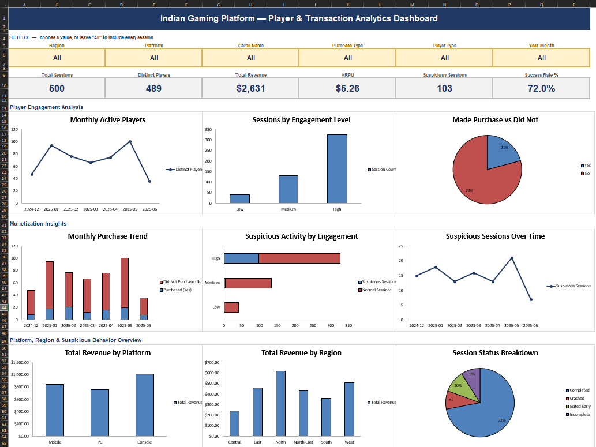

# Gaming Platform Player & Transaction Analysis (Excel)

An Excel deep-dive into 500 gameplay sessions from an Indian gaming
platform — cleaning the data, building out a few derived metrics, and
putting it all into one interactive dashboard.

## Why this project

Gaming platforms live and die by engagement and monetization data. I
wanted to practice the full Excel workflow end to end: take a messy-ish
export, clean it properly, build the metrics a product team would actually
ask for, and package it into a dashboard someone could open and use —
not just a pile of charts.

## The data

`Dataset/Gaming_Case_Study_Excel_Dataset.xlsx` — 500 sessions, Dec 2024
to Jun 2025, across 5 games, 3 platforms, and 6 regions. Each row has
session length, purchase amount, purchase type, player type, and a flag
for suspicious (bot-like) activity.

## What I did

**Cleaned it properly.** Ran 13 live checks (duplicates, missing values,
negative/unrealistic numbers, date range, text formatting) — turns out
the raw data was already clean on every mechanical check. The one real
finding: the documented "Is Suspicious" rule (duration >150 min **AND**
purchase >$40) doesn't actually match the data. The real logic is an
**OR**, not an AND. Worth flagging back to whoever wrote that rule.

**Added a few calculated columns**: Year-Month, an Engagement Level
bucket (Low/Medium/High by session length), a Made Purchase flag, and a
numeric version of the suspicious flag.

**Built 10 summary tables** off those columns, then a dashboard on top —
9 charts, 6 dropdown filters, and a KPI strip that updates live.

## The dashboard

KPIs: Total Sessions, Distinct Players, Total Revenue, ARPU, Suspicious
Sessions, Success Rate — all update when you use the filters (Region,
Platform, Game, Purchase Type, Player Type, Month).

Charts cover monthly active players, engagement mix, purchase trends,
suspicious activity, and platform/region performance.

> Note: the filters are formula-driven, not native Excel Slicers —
> Slicers only bind to real PivotTables, which you can't generate outside
> Excel itself. If you want click-to-filter Slicers on every chart, drop
> `Transformed Data` into a PivotTable inside Excel and build from there.

## What stood out

- **65% of sessions are "High engagement"** (60+ min) — and 95% of the
  suspicious-flagged sessions fall in that same bucket. Long sessions and
  bot activity are clearly correlated here.
- **Only ~21% of sessions include a purchase**, but that's where all
  $2,631 of revenue comes from — Free players spend nothing, ARPU among
  Paid sessions is about $17.78.
- **Console edges out Mobile and PC** on both revenue and completion
  rate.
- **28% of sessions don't finish cleanly** (crashed, exited early, or
  incomplete) — a bigger lever on revenue than most people would guess.
- **North region brings in the most revenue** despite average session
  volume; Central lags on both.

## If I were handing this to a product team

1. Pull device/IP data for the high-engagement + suspicious overlap —
   that's the platform's clearest bot signal.
2. Fix the documented suspicious-activity rule (AND → OR).
3. Prioritize the crash/exit-early issue before spending on acquisition —
   28% of sessions failing probably costs more than churn.
4. Test a light purchase nudge for engaged Free users — they're already
   spending time, just not money.

## In this repo

- `Dataset/Gaming_Case_Study_Excel_Dataset.xlsx` — raw data
- `Dashboards/Gaming_Platform_Analysis.xlsx` — full workbook (Dashboard,
  Summary Tables, Transformed Data, Cleaned Data, Cleaning Log, Raw Data)
- `Dashboards/dashboard_preview.png` — dashboard screenshot
- `README.md` — this file

## Skills

Excel (SUMIFS, COUNTIFS, SUMPRODUCT, AVERAGEIFS, TEXT, IF), data
cleaning, data transformation, dashboard design, business analysis.
